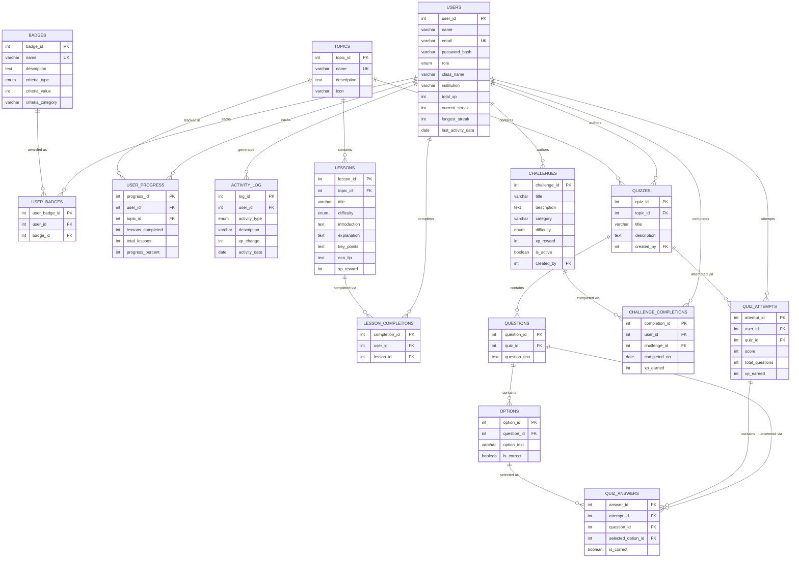

# EcoQuest — Database Design

MySQL 8, `utf8mb4`, InnoDB (for foreign key support). Full DDL:
[`database/schema.sql`](../database/schema.sql). Demo data:
[`database/seed.sql`](../database/seed.sql).

## 1. Tables (14)

| Table | Purpose |
|---|---|
| `users` | Students, teachers and admins (single table, `role` enum) |
| `topics` | The 6 environmental categories |
| `lessons` | Lesson content per topic |
| `lesson_completions` | Which student completed which lesson |
| `quizzes` | One quiz per topic (or more) |
| `questions` | Questions belonging to a quiz |
| `options` | 4 options per question, one `is_correct` |
| `quiz_attempts` | A student's attempt at a quiz (score, XP earned) |
| `quiz_answers` | Per-question answer within an attempt (for review screens) |
| `challenges` | Real-world eco-challenges |
| `challenge_completions` | Which student completed which challenge, on which day |
| `badges` | Badge definitions and unlock criteria |
| `user_badges` | Which student has earned which badge |
| `user_progress` | Cached per-topic completion percentage per student |
| `activity_log` | Every XP-earning event (drives streaks + "recent activity") |

## 2. Entity-Relationship Diagram



## 3. Cardinality Summary

| Relationship | Cardinality |
|---|---|
| User → QuizAttempt | 1 : N |
| Quiz → Question | 1 : N |
| Question → Option | 1 : N (exactly 4 in practice) |
| Topic → Lesson | 1 : N |
| Topic → Quiz | 1 : N |
| User → ChallengeCompletion | 1 : N |
| Challenge → ChallengeCompletion | 1 : N |
| User ↔ Badge | N : M (via `user_badges`) |
| User → UserProgress | 1 : N (one row per topic) |
| User ↔ Lesson | N : M (via `lesson_completions`) |

## 4. Key Design Decisions

- **Single `users` table with a `role` enum** rather than separate
  Student/Teacher/Admin tables — all three share the same core attributes
  (name, email, password) and this avoids duplicate auth logic. Role-only
  fields (`total_xp`, `current_streak`, …) are simply `0`/`NULL` for
  teachers and admins.
- **`user_progress` is a cache, not a source of truth** — it is
  recalculated from `lesson_completions` every time a lesson is completed
  (`utils/gamification.update_topic_progress`), so it can never silently
  drift from the underlying completion data; it exists purely so the
  dashboard doesn't need an expensive join+aggregate on every page load.
- **`UNIQUE (user_id, lesson_id)`** on `lesson_completions` and
  **`UNIQUE (user_id, challenge_id, completed_on)`** on
  `challenge_completions` enforce "can't complete the same lesson twice"
  and "can't complete the same challenge more than once per day" at the
  database level, not just in application code.
- **`ON DELETE CASCADE`** on child tables (lessons, questions, options,
  completions, etc.) keeps the database consistent if a topic/quiz/user is
  removed, without requiring manual cleanup code.
- **Indexes** on foreign keys and on `users.total_xp` (used by the
  leaderboard's `ORDER BY total_xp DESC`) keep the common queries fast even
  as data grows, without needing a caching layer.

## 5. Example Queries (also used verbatim in the application code)

```sql
-- Leaderboard
SELECT name, total_xp, RANK() OVER (ORDER BY total_xp DESC) AS rnk
FROM users WHERE role = 'student' ORDER BY total_xp DESC;

-- A student's topic-wise progress
SELECT t.name, COALESCE(up.progress_percent, 0) AS progress_percent
FROM topics t
LEFT JOIN user_progress up ON t.topic_id = up.topic_id AND up.user_id = ?
ORDER BY t.topic_id;

-- Average quiz score per quiz (teacher dashboard)
SELECT q.title, AVG(qa.score / qa.total_questions * 100) AS avg_pct
FROM quizzes q LEFT JOIN quiz_attempts qa ON q.quiz_id = qa.quiz_id
GROUP BY q.quiz_id, q.title;
```
