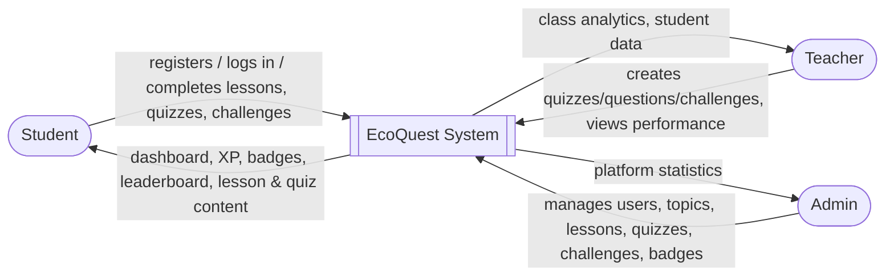
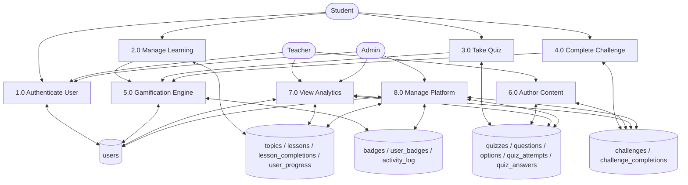

# EcoQuest — Data Flow Diagrams

These diagrams describe only processes, data stores and external entities
that actually exist in the implemented application.

## Level 0 (Context Diagram)

## Level 1 (Major Processes)

**Process descriptions:**

| # | Process | Description |
|---|---|---|
| 1.0 | Authenticate User | Register, login, logout, session/role checks |
| 2.0 | Manage Learning | Browse topics, read lessons, mark complete, recompute progress |
| 3.0 | Take Quiz | Navigate questions, submit answers, score, award XP |
| 4.0 | Complete Challenge | Mark a challenge done (once/day), award XP |
| 5.0 | Gamification Engine | Award XP, compute level, update streak, check badge criteria |
| 6.0 | Author Content | Teacher creates quizzes/questions/challenges |
| 7.0 | View Analytics | Teacher/Admin dashboards (aggregated SQL queries) |
| 8.0 | Manage Platform | Admin CRUD on users/topics/lessons/quizzes/challenges/badges |

A Level 2 diagram was not produced — none of the Level 1 processes are
complex enough to need further decomposition for this project's scope.
