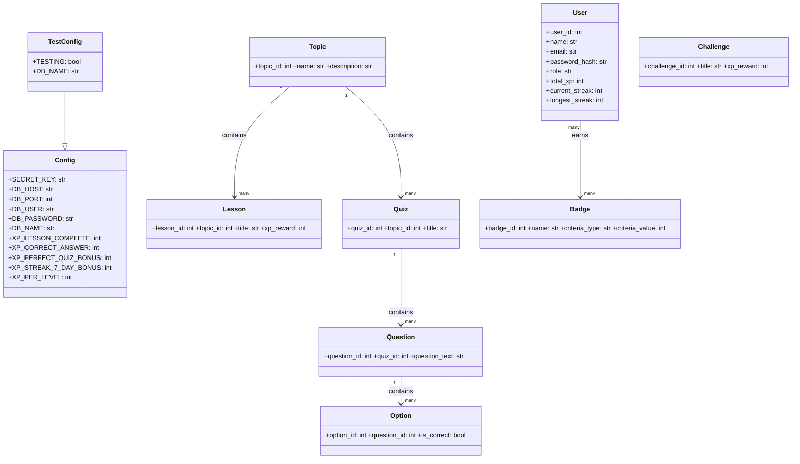
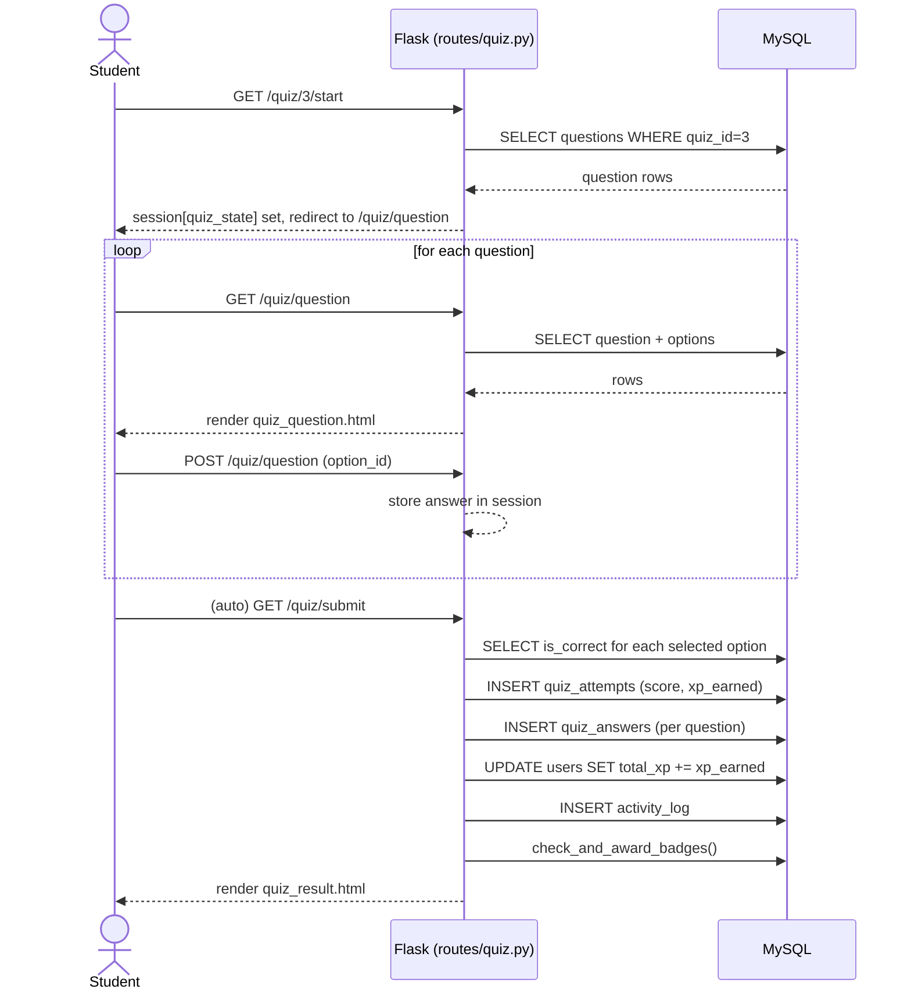
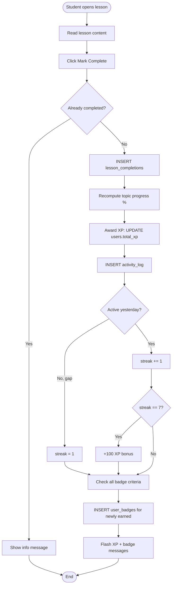
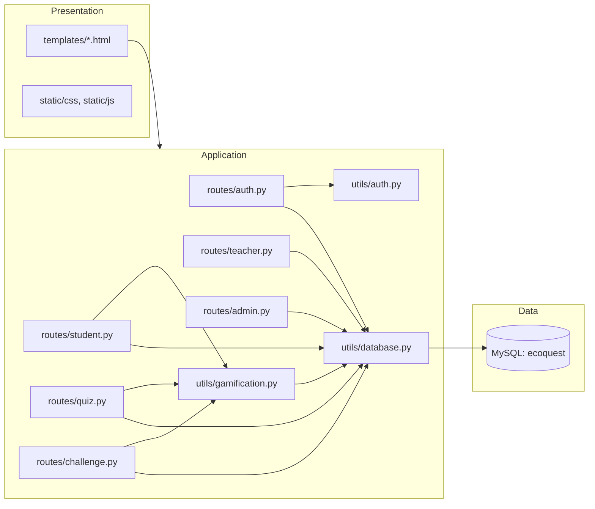
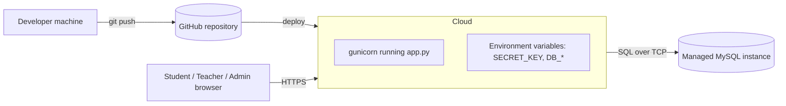

# EcoQuest — UML Diagrams

These diagrams reflect the actual implemented modules (`routes/`, `utils/`)
rather than a generic OOP design, since the application is built as Flask
functions/blueprints rather than a class hierarchy. Where the project does
use classes (e.g. `Config`), that is shown too.

## 1. Class Diagram (Configuration + conceptual data classes)

*(`User`, `Topic`, `Lesson`, etc. are represented as MySQL rows/dict
records in the actual code, not Python classes — see `utils/database.py`
which returns plain `dict`s via `pymysql.cursors.DictCursor`. They are
shown here as classes purely for the conceptual data model, per usual UML
convention for ER-backed systems.)*

## 2. Sequence Diagram — Taking a Quiz

## 3. Activity Diagram — Lesson Completion → Gamification

## 4. Component Diagram

## 5. Deployment Diagram

